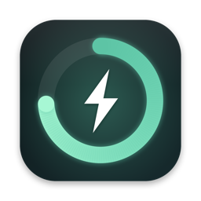
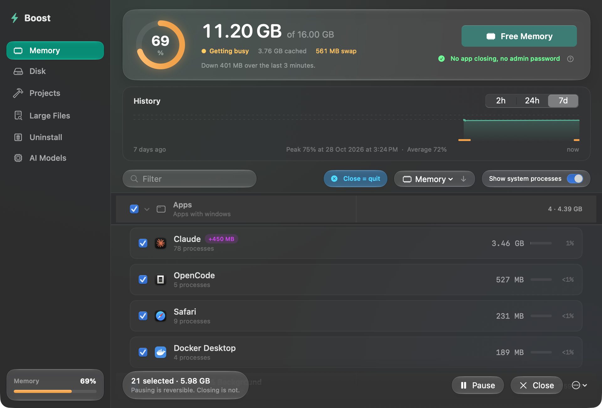
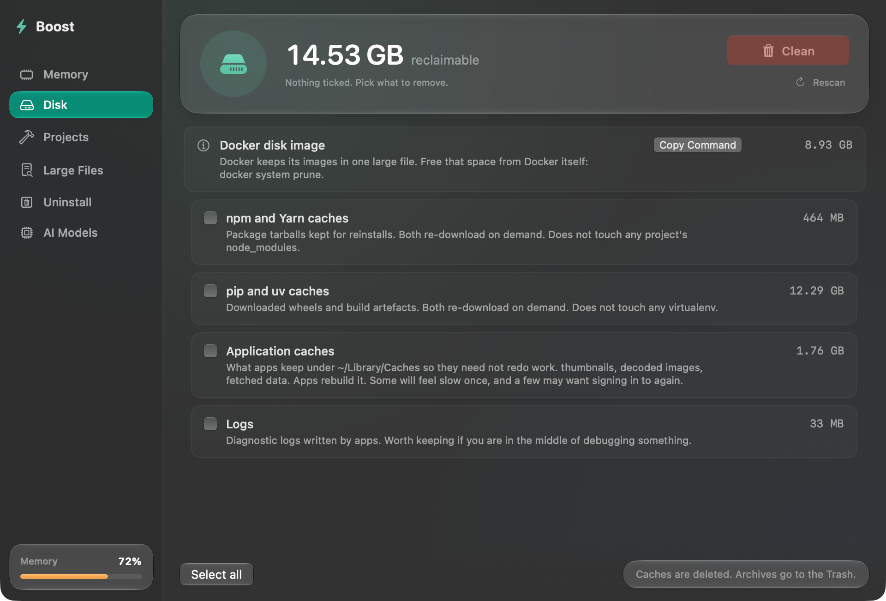
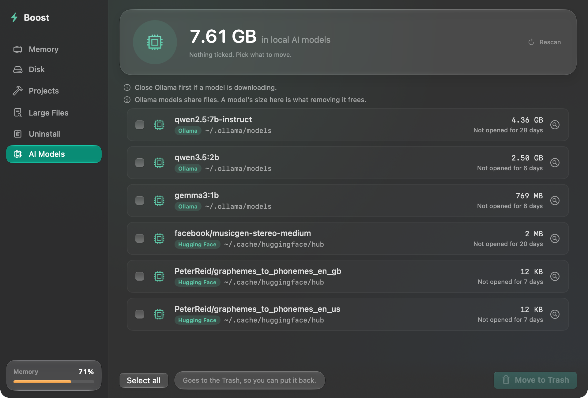
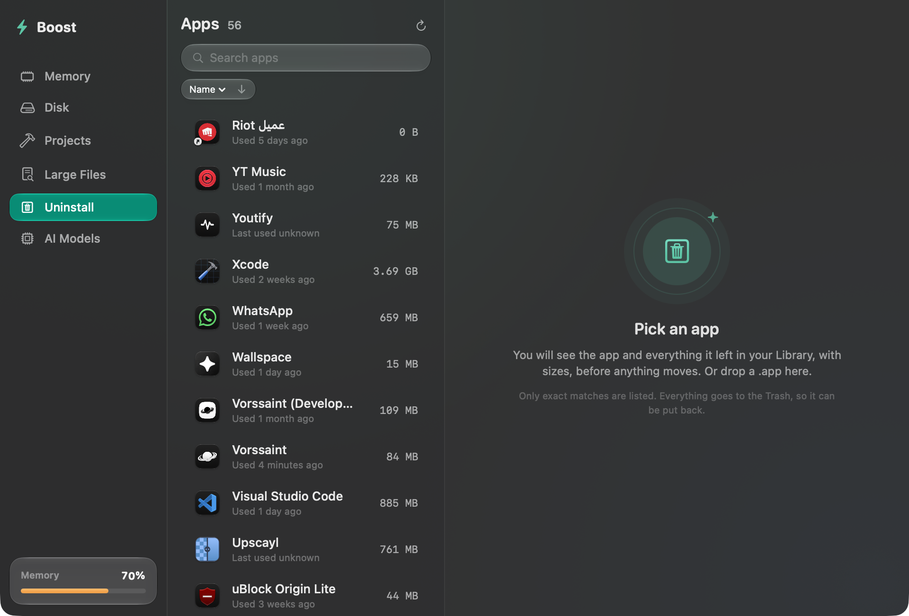
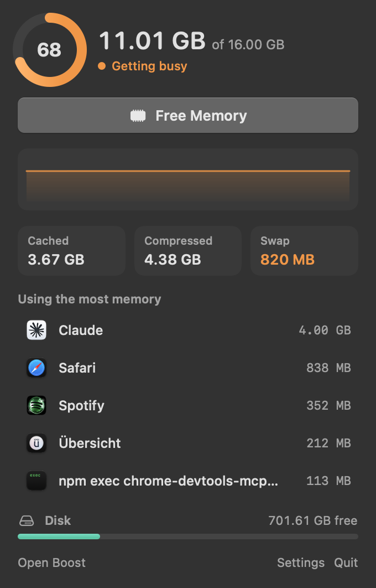

<div align="center">



# Boost

**A free, open source Mac app for memory and disk space.**<br>
It lives in your menu bar, shows what is really using your RAM, pauses apps you are not using, and finds what is safe to remove.

[](https://github.com/Kernel-Hunter/boost/releases/latest)
[](https://github.com/Kernel-Hunter/boost/stargazers)
[](LICENSE)
[](https://github.com/Kernel-Hunter/boost/releases/latest)
[](https://github.com/Kernel-Hunter/boost/releases/latest)

[Website](https://kernel-hunter.github.io/boost/) &nbsp;·&nbsp;
[Download](https://github.com/Kernel-Hunter/boost/releases/latest) &nbsp;·&nbsp;
[Guides](https://kernel-hunter.github.io/boost/guides/) &nbsp;·&nbsp;
[Report a bug](https://github.com/Kernel-Hunter/boost/issues/new/choose)

<br>



</div>

<br>

If you looked at CleanMyMac, iStat Menus or AppCleaner and did not want a
subscription, Boost covers the parts most people actually use. No account, no
analytics, and the only network request it makes is an update check you can
turn off.

## Install

```bash
brew install --cask kernel-hunter/boost/boost
```

Or build it yourself. It takes about as long and involves no Gatekeeper at all:

```bash
git clone https://github.com/Kernel-Hunter/boost.git
cd boost && ./Scripts/build.sh
```

Needs macOS 14 or later. One universal binary for Apple Silicon and Intel. It
builds with the Command Line Tools, so Xcode is not required.

### Updating

From 1.5.0 on, Boost updates itself. Choose Check for Updates… in the Boost
menu, or let it check once a day (it asks the second time you open it). When a
new version is out you see what changed and click Install. There is nothing to
delete or download by hand, and this works the same if you installed with
Homebrew.

If you have 1.4.1 or older, update once the old way (`brew upgrade --cask boost`,
or download the new zip). After that the app does it.

<details>
<summary><b>About signing and Gatekeeper</b></summary>

<br>

Boost is not notarized, because notarizing needs a paid Apple Developer
account. A downloaded `.zip` will be stopped by Gatekeeper
the first time. The Homebrew cask clears the quarantine flag for you, and building
from source never sets one, so use one of those two.

If you downloaded the zip anyway: on macOS 14, right-click the app and choose
Open. On macOS 15 and later, open it once, then go to System Settings, Privacy &
Security, and click Open Anyway next to the message about Boost.

</details>

## What it does

| | |
| --- | --- |
| **Menu bar popover** | Memory pressure, a short graph, swap, cached and compressed memory, and the five apps using the most. Point at one to pause or quit it. Free Memory is one click away. |
| **A week of history** | One reading a minute for seven days. Chart it over 2 hours, 24 hours or 7 days, with the peak, the average and how often your Mac went into swap. |
| **Pause, not quit** | Freezes an app and its helpers. No CPU, state kept, resumes exactly where it was. Pause apps automatically after 5 to 60 minutes in the background. |
| **Alerts that mean something** | A notification when swap passes 1, 2 or 4 GB, or memory stays tight for a full minute. It names the app using the most. Brief spikes are ignored. |
| **Disk** | Caches the owning tool rebuilds: Homebrew, npm, pip, Cargo, Gradle, Xcode DerivedData and device support, simulators, app caches, logs. Docker's disk image is shown with the command to shrink it, never deleted. |
| **Projects** | Old `node_modules`, Rust `target`, SwiftPM `.build`, virtualenvs and CocoaPods in projects you have not touched for 30 to 180 days. |
| **Large Files** | The biggest files in Downloads, Desktop, Documents, Movies, Music and Pictures, with when you last opened each. |
| **AI Models** | Models that Ollama, Hugging Face and LM Studio downloaded, with sizes. Ollama models share files, so each size is what removing that one frees. |
| **Uninstall** | Pick an app or drop one on the window. Leftovers in your Library are listed with sizes before anything moves, with an Undo. |
| **Copy Report** | A plain text summary for a bug report: your Mac, pressure, swap, biggest apps. App names and sizes only, no file paths, nothing sent anywhere. |

Also: start at login, a Dock badge, an optional global shortcut (⌥⌘B), light and
dark mode, and Liquid Glass on macOS 26. Older systems get a plain material look.

## Screenshots

<table>
  <tr>
    <td width="50%"></td>
    <td width="50%"></td>
  </tr>
  <tr>
    <td align="center"><sub><b>Disk</b>: nothing is ticked for you</sub></td>
    <td align="center"><sub><b>AI Models</b>: what removing each one frees</sub></td>
  </tr>
  <tr>
    <td width="50%"></td>
    <td width="50%" align="center"></td>
  </tr>
  <tr>
    <td align="center"><sub><b>Uninstall</b>: leftovers listed before anything moves</sub></td>
    <td align="center"><sub><b>Menu bar popover</b></sub></td>
  </tr>
</table>

https://github.com/user-attachments/assets/80e43cb2-c93a-4dbd-94ce-54885221b0df

## Why it is built this way

Most Mac cleaners show you a big number and offer to make it smaller. The number
is usually cached memory, which macOS is using well, and shrinking it makes your
Mac slower. Boost does the opposite on purpose.

- **It tells you when there is nothing to do.** If swap is at zero, the header
  says your Mac is coping.
- **It explains a figure before offering to change it.** Cached memory is shown
  as available, because it is.
- **Nothing is ticked for you.** Removing files should be a decision.
- **Almost everything goes to the Trash**, so you can put it back. Only the
  caches in the Disk tab are deleted, and the screen says so.
- **Two safety layers guard deletion.** An allowlist of what may be scanned, and a
  second check of the resolved path right before each removal. A symlink in a
  cache that points at your documents is how tools like this destroy data, and
  there is a test that builds exactly that trap.

New to the topic? The [guides](https://kernel-hunter.github.io/boost/guides/)
explain memory pressure, cached memory, System Data and how to uninstall an app
completely, with or without Boost.

## FAQ

<details>
<summary><b>Does Free Memory actually work?</b></summary>

<br>

Windows tools like Mem Reduct call `EmptyWorkingSet`, which lets one process push
another process's pages to the pagefile. macOS has no public equivalent, as
[Apple's kernel source](https://github.com/apple-oss-distributions/xnu/blob/main/doc/vm/memorystatus_notify.md)
shows. It also would not help. macOS compresses memory instead of swapping early,
and reading a compressed page from RAM is much faster than reading it back from an
SSD.

So Boost uses what macOS does offer. It asks the system for memory through Apple's
own `memory_pressure` tool, which nudges the kernel to release idle pages and
compress what it can. Then it checks the readings before and after and reports
only what actually stopped being used. It does not close apps, delete files or ask
for a password, and it stops early if swap starts growing.

Expect a few hundred MB to around a gigabyte on a typical run. If your Mac is not
short on memory, there is little sitting idle to give back. Settings has an
aggressive mode that asks harder. It is off by default and warns you why: pushed
far enough, the kernel may kill something on its own.

</details>

<details>
<summary><b>What permissions does it need?</b></summary>

<br>

| What | Why | When |
| --- | --- | --- |
| None | Reading the process table and memory stats, and signalling your own apps | Always |
| Accessibility | Counting an app's open windows | Only for "close button quits the app" |
| Notifications | The swap and pressure alerts | Only if you turn them on |
| Login item | Starting Boost at login | Only if you turn it on |
| Admin password | `/usr/sbin/purge` | Only if you turn on the optional disk cache purge |

No analytics and no telemetry. The one network request Boost makes is the update
check: it downloads a small file listing the latest version from
`kernel-hunter.github.io` over HTTPS. It sends no identifiers, only what any
download sends (your IP address, and a User-Agent naming Boost's version). It
happens only after you say yes to automatic checks, or when you click Check for
Updates. Turn it off in Settings, under Updates. See [SECURITY.md](SECURITY.md).

</details>

<details>
<summary><b>Is it safe to pause an app?</b></summary>

<br>

Pause sends the app and its helpers `SIGSTOP`, and resuming sends `SIGCONT`. Boost
writes what it froze to a lease file and runs a small watchdog, so if Boost
crashes or is killed, everything it froze is resumed. It never pauses itself, and
an alert can pause apps you ticked but cannot close them.

</details>

<details>
<summary><b>Is it really free?</b></summary>

<br>

Yes, and the parts that matter always will be. Safety, honest readings and
anything that already shipped free are not going behind a paywall. The rules are
written into [`Pro.swift`](Sources/BoostKit/Pro.swift).

</details>

<details>
<summary><b>Is there a command line version?</b></summary>

<br>

`boost.sh` does the same job headlessly, for a hotkey or a script:

```bash
./boost.sh              # close apps and helpers
./boost.sh --pause      # freeze them instead
./boost.sh --resume     # unfreeze everything, system-wide
./boost.sh --dry-run    # show what it would touch, change nothing
```

Pins made in the app are written to `~/Library/Application Support/Boost/keep.txt`,
and the script reads the same file.

</details>

## Building and contributing

```bash
./Scripts/build.sh          # build and install to /Applications
./Scripts/test.sh           # run the suite
```

Use `Scripts/test.sh` rather than `swift test`. See
[CONTRIBUTING.md](CONTRIBUTING.md) for the two flags it needs and why their error
messages blame the wrong thing. Issues and pull requests are welcome. The bug
report form asks for a Copy Report from the popover, which makes memory problems
much easier to track down.

To regenerate the screenshots from the real views:

```bash
swift build && .build/debug/boost --snapshot docs/snapshots
```

## License

GPL-3.0. See [LICENSE](LICENSE).

<div align="center">
<br>
Built by <a href="https://github.com/Kernel-Hunter">Karim Masmoudi</a>. If Boost is useful to you, a star helps other people find it.
</div>
